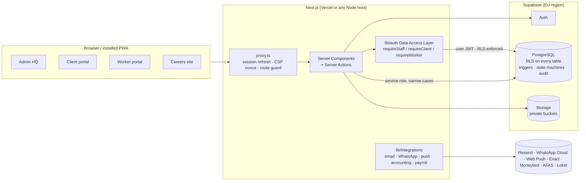

# Architecture

## Overview

ShiftPilot is a **modular monolith**: one Next.js application serving four portals, backed by one Supabase project
(PostgreSQL, Auth, Storage). Business rules that protect data integrity live **in the database** (constraints,
triggers, RLS, transactional functions) so that every client — the web app, a future mobile app, an integration or
an AI assistant — is held to the same rules.

## Layers of authorisation (defence in depth)

1. **Proxy** (`src/proxy.ts`) — redirects signed-out visitors from portal routes. Convenience only.
2. **Data Access Layer** (`src/lib/auth/session.ts`) — every page and server action calls `requireStaff(...perms)`,
   `requireClient()` or `requireWorker()`. The active agency/client comes from a cookie but is always validated
   against the user's actual memberships.
3. **PostgreSQL RLS** — the final authority. All user-initiated queries use the user's JWT
   (`lib/supabase/server.ts`), so a bug in layers 1–2 cannot leak another tenant's data.
4. **Database guards** — triggers block privilege escalation (e.g. workers changing their own status, clients
   escalating their membership), enforce state machines, and make financial and audit records immutable.

The **service-role client** (`lib/supabase/admin.ts`, `server-only`) is used only where no user context exists or the
action is on behalf of someone without an account: looking up an invitation by its secret token, shared rate limiting,
the agency bootstrap and (later) background jobs. It is never imported into client components.

## Multi-tenancy

- Every agency-owned row has `agency_id`. Composite foreign keys (`(agency_id, client_id)` →
  `clients(agency_id, id)`) make cross-tenant references impossible at the schema level.
- `agency_id` is immutable after insert (trigger).
- Staff membership: `user_roles`. Client users: `client_memberships` (+ optional location scope). Workers: `workers.user_id`.
  A single person may hold several (e.g. staff and worker) and choose the portal at `/portal`.

## Key design decisions

| # | Decision | Rationale |
| --- | --- | --- |
| ADR-1 | Build ShiftPilot in `shiftpilot/`, separate from the existing tour-booking app | The repository already contains a live, unrelated product with its own production database; it must not be overwritten |
| ADR-2 | Next.js 16 App Router, **Cache Components disabled** | All portal pages are per-user and RLS-protected; request-time rendering avoids accidental cross-user caching |
| ADR-3 | Integrity rules in PostgreSQL | Double-booking (GiST exclusion), headcount (row lock), state machines, immutability and audit cannot be bypassed by any client |
| ADR-4 | Permission catalogue as data (`permissions`, `roles`, `role_permissions`) mirrored by a TS constant with a test that fails on divergence | Custom roles per agency without code changes; type-safe UI checks |
| ADR-5 | Separate employee and freelancer pathways (tables, triggers, financial flows) | Legal distinction; a freelancer is never auto-classified |
| ADR-6 | Statutory values (minimum wage, CAO tables, pension %) are configured by the agency with a source reference — never seeded | Avoids invented legal figures; values are versioned by effective date |
| ADR-7 | Integrations are optional adapters returning `not_configured` | The core keeps working without them; delivery is never simulated |
| ADR-8 | Tests run migrations on plain PostgreSQL 16 with a Supabase shim; CI additionally applies them on the real Supabase stack | Fast, Docker-free RLS testing plus platform fidelity |
| ADR-9 | Nonce-based CSP issued in the proxy | Blocks injected scripts; nonces require dynamic rendering, which ADR-2 already implies |
| ADR-10 | Native `<select>` in forms | Accessible, works without JavaScript and on every mobile device |

## Module map (roadmap phases)

| Domain | Schema | UI |
| --- | --- | --- |
| Identity, roles, audit | ✅ | ✅ settings, team, roles, audit log, account |
| CRM & clients | ✅ | Phase 2 |
| Workers, documents | ✅ | Phase 2 |
| Industry & positions | ✅ | Phase 2 |
| Recruitment | ✅ | Phase 2 |
| Scheduling, matching | ✅ (state machine, concurrency) | Phase 3 |
| Attendance, timesheets | ✅ (immutability) | Phase 4 |
| Finance | ✅ (invoices, payments, payroll export, purchase invoices) | Phase 5 |
| Compliance, GDPR | ✅ | Phase 6 |
| Communication, automation | ✅ (queues) | Phase 7 |
| Integrations | ✅ (accounts, webhooks) | Phases 5–7 |
