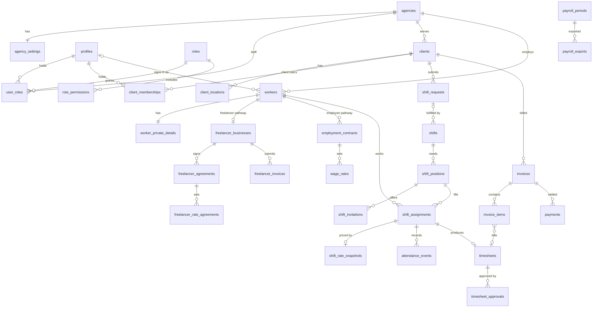

# Database

PostgreSQL (Supabase), 108 tables in `public`, 2 views, private helper functions in schema `app` (not exposed through
the Data API). Every table has Row Level Security enabled — migration 0014 **fails** if any table lacks it.

## Conventions

- `uuid` primary keys (`gen_random_uuid()`); `bigint identity` for append-only logs.
- `agency_id` on every tenant-owned table, immutable after insert. Child tables reference parents with composite
  foreign keys `(agency_id, parent_id)` so rows can never point across tenants.
- `created_at` everywhere; `updated_at` maintained by trigger where rows are mutable.
- No hard deletes for business records: status + `archived_at`, or end-dating for rates. Foreign keys use
  `ON DELETE RESTRICT` for anything with history.
- Append-only tables (UPDATE/DELETE raise an error even for the superuser): `audit_logs`, `user_sessions`,
  `state_transitions`, `attendance_events`, `timesheet_approvals`, `document_versions`, `payments`, `credit_notes`,
  `payroll_export_lines`, `shift_rate_snapshots`, `eligibility_checks`, `consent_records`.
- Money: `numeric(14,2)` amounts, `numeric(10,4)` rates. Times: `timestamptz` (UTC), shown in the agency time zone.
- Enums for stable state sets; `text` + `CHECK` for sets expected to grow.

## Migrations

| File | Domain | Tables |
| --- | --- | --- |
| 0001 foundation | extensions, `app` schema, shared triggers/enums | — |
| 0002 identity_access | tenancy, auth profiles, RBAC, audit | agencies, agency_settings, profiles, permissions, roles, role_permissions, user_roles, user_sessions, audit_logs |
| 0003 crm_clients | CRM and clients | clients, client_locations, client_contacts, client_memberships, client_membership_locations, client_contracts, contract_terms, leads, lead_activities, internal_notes |
| 0004 workers_core | workforce | workers, worker_private_details |
| 0005 industry_config | configurable industries/positions | industries, rate_categories, job_categories, job_positions, skills, qualifications, certificates, position_requirements |
| 0006 workforce_documents | credentials, availability, documents | worker_skills, worker_languages, worker_experience, worker_availability, document_types, documents, document_versions, worker_certificates, worker_qualifications (+ view worker_documents) |
| 0007 employment_freelance | the two pathways | cao_configurations, minimum_wage_rates, employer_cost_profiles, employment_contracts, employment_terms, wage_rates, leave_records, payroll_periods, freelancer_businesses, freelancer_registrations, freelancer_agreements, freelancer_rate_agreements |
| 0008 recruitment_invitations | recruitment, onboarding, invitations | job_openings, applications, application_documents, interviews, screening_records, onboarding_tasks, invitations |
| 0009 scheduling | requests, shifts, assignments | state_machine_transitions, state_transitions, shift_requests, shifts, shift_positions, shift_assignments, shift_invitations, assignment_eligibility, shift_rate_snapshots |
| 0010 attendance_timesheets | attendance | attendance_events, break_records, timesheets, attendance_corrections, timesheet_entries, timesheet_approvals |
| 0011 finance | billing, payroll export, purchases | client_rate_cards, client_rate_rules, invoice_sequences, invoices, invoice_items, credit_notes, payments, payroll_exports, payroll_export_lines, payslips, freelancer_invoices, freelancer_invoice_lines, purchase_invoices, financial_periods |
| 0012 communication | notifications, messaging, queues | notifications, notification_preferences, push_subscriptions, notification_deliveries, conversations, conversation_participants, messages, automation_jobs |
| 0013 compliance_gdpr | compliance, GDPR | compliance_rules, eligibility_checks, compliance_reviews, incidents, processing_activities, consent_records, data_subject_requests, data_retention_records, breach_records (+ view document_expiries) |
| 0014 integrations_storage_bootstrap | integrations, storage, bootstrap, hardening | integration_accounts, webhook_endpoints, webhook_events, external_reference_mappings |
| 0015 rate_limits | shared rate limiting | rate_limit_buckets |

Mapping to the specification's table names: `users` is Supabase's `auth.users` (application data in `profiles`);
`worker_documents` is a view over `documents`; `document_expiries` is a view over documents and credentials;
`freelancer_invoices` are the freelancer purchase invoices and `purchase_invoices` hold other direct supplier costs.

### Applying migrations

```bash
supabase db reset                 # local: rebuild from scratch
supabase db push                  # hosted: apply pending migrations (see DEPLOYMENT.md)
npm run test:db                   # plain PostgreSQL 16 + shim: apply all + run tests
npm run db:types                  # regenerate src/lib/database.types.ts
```

Never edit a migration that has been applied to a shared environment; add a new one. Destructive changes to
production data require a reviewed migration plus a backup (BACKUP_AND_RECOVERY.md).

### Seed data

There is no sample data. `bootstrap_agency()` (service role only, invoked by `scripts/bootstrap-agency.mjs`) creates an
agency with its settings row, the ten default industries and the default document types, and assigns the owner role.
The permission catalogue and system roles are reference data inserted by migration 0002.

## Core entity relationships



## Integrity mechanisms

| Rule | Mechanism |
| --- | --- |
| No double-booking | `EXCLUDE USING gist (worker_id WITH =, tstzrange(starts_at, ends_at) WITH &&)` on active assignments; times kept in sync when a shift is rescheduled (the reschedule fails if it would create a conflict) |
| Headcount never exceeded | Assignment trigger locks the `shift_positions` row (`FOR UPDATE`) and recounts inside the transaction |
| Valid lifecycle | `state_machine_transitions` table + `app.enforce_state_machine()` trigger on requests, shifts, assignments, invitations, timesheets, invoices; every change logged in `state_transitions` |
| Pathway separation | Triggers: employment records only for `employee` workers; freelancer businesses/invoices only for `freelancer` workers; positions declare `allowed_engagements` |
| Immutable rates | Wage, freelancer and minimum-wage rates can only be end-dated; overlapping periods rejected by exclusion constraints; per-assignment `shift_rate_snapshots` are append-only |
| Approved hours frozen | Timesheets locked after client approval; corrections become `adjustment` entries linked to an approved correction |
| Invoice integrity | Totals derived from items; gapless numbering per series/year under a row lock; issued invoices immutable; payment status derived from append-only payments |
| Audit | `app.audit_row_change()` on sensitive tables records actor, old/new values (IBAN and secrets redacted) and changed fields |

## Generated types

`src/lib/database.types.ts` is generated by `scripts/gen-db-types.mjs` (same shape as `supabase gen types`, including
FK relationships, so typed embedded selects work). CI fails if it is out of date.
